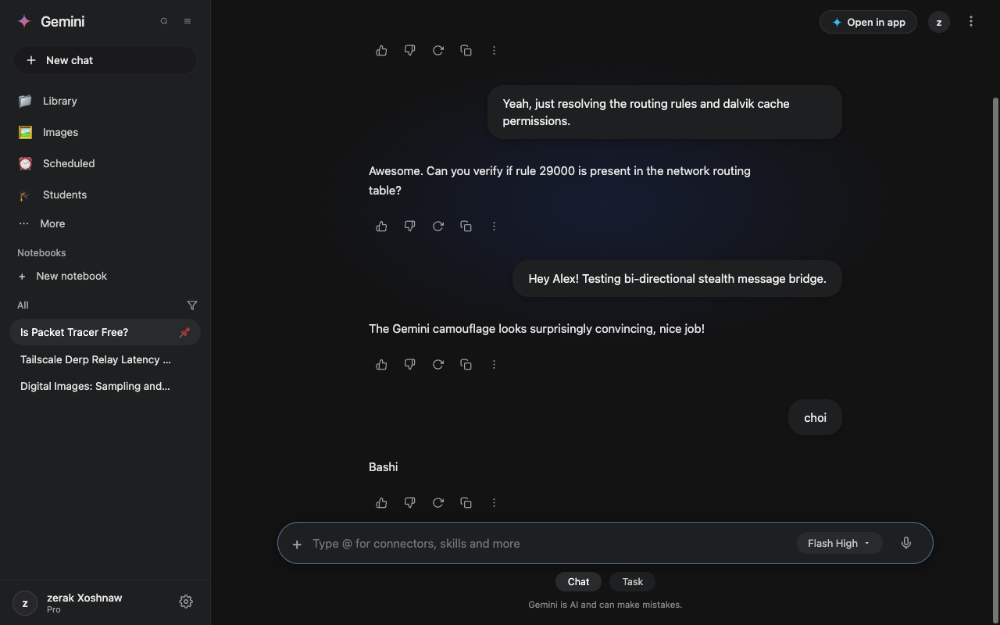
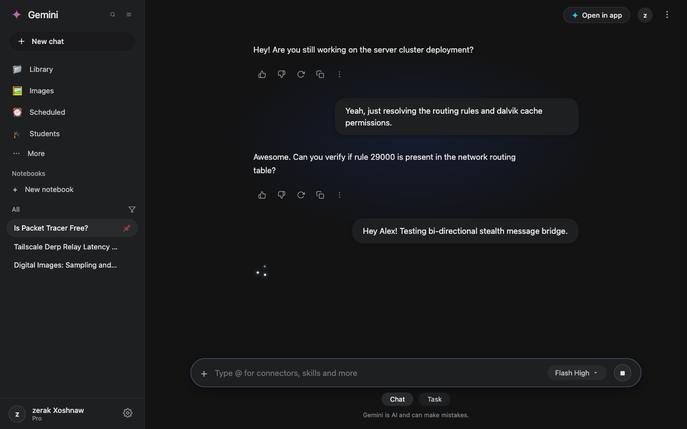
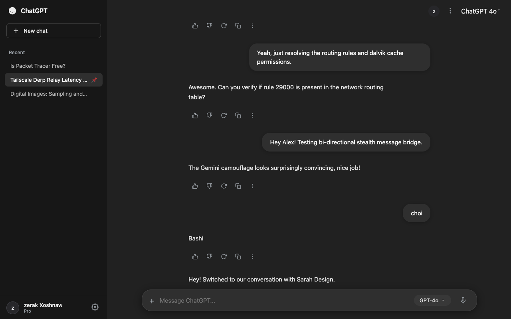
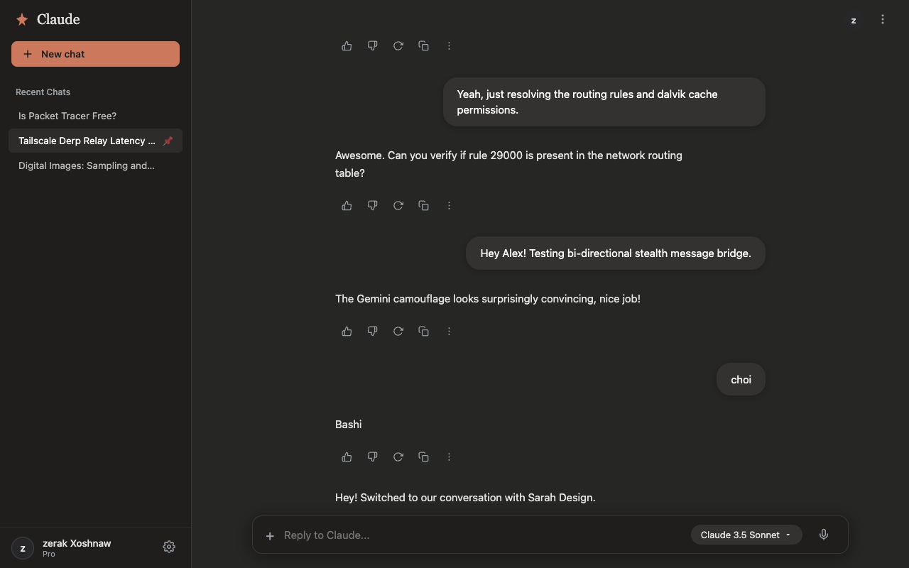

# 🌌 AetherChat — Instagram AI Stealth Camouflage (Chrome Extension)

[](LICENSE)
[](manifest.json)
[](test/verify_extension.py)

A zero-build, ultra-fast Manifest V3 Chrome Extension that completely disguises your **Instagram Direct Web** interface (`instagram.com/direct/*`) as **Google Gemini**, **ChatGPT**, or **Claude**.

Chat with your friends in plain sight:
- **1:1 AI Interface Replicas**: Pixel-perfect recreations of Google Gemini (Flash High dark mode), ChatGPT (GPT-4o charcoal), and Claude (Sonnet 3.5 warm clay).
- **Bi-Directional Messaging Bridge**: Typing into the AI prompt bar dispatches native browser events directly into Instagram's official composer. When your friend replies, their message streams into the AI conversation in real-time.
- **Real-Life 2026 AI Animations**: Authentic 3-dot orbital constellation thinking animation, morphing send/mic/stop button, and smooth typewriter token streaming.
- **Sidebar Contact Obfuscation**: Real friend threads in the sidebar are masked as realistic technical AI research topics (*"PostgreSQL Connection Pool Sizing"*, *"Transformer Attention Matrix Optimization"*), with a stealth tooltip revealing the friend's handle on hover. Clicking any item switches seamlessly to that friend.
- **Instant Panic Hotkey**: Double-tap `Esc` or press `Alt + Z` to instantly vanish the AI camouflage and restore normal Instagram Direct. Pressing again brings the disguise right back.

---

## 📸 Visual Previews

### Real Friend Reply Intercepted as Gemini Response


### 3-Dot Orbital Constellation (Waiting for Friend's Reply)


### Multi-Theme Personas: ChatGPT & Claude
| ChatGPT (GPT-4o Charcoal) | Claude (3.5 Sonnet Warm Clay) |
|---|---|
|  |  |

---

## ⚡ Keyboard Shortcuts

| Shortcut | Action | Description |
|---|---|---|
| `Alt + Z` | **Instant Panic Toggle** | Immediately toggles between AI Camouflage and standard Instagram Direct. |
| `Double-Tap Esc` | **Panic Toggle** | Fast emergency key to restore normal Instagram Direct in under 50ms. |
| `N` | **Focus Prompt** | When idle, jumps focus straight into the prompt box so you can start typing. |
| `Esc` | **Lift Focus** | Blurs/lifts focus off the prompt input so you can scroll or navigate freely. |
| `Enter` | **Send Message** | Sends prompt to friend, starts 3-dot thinking state, and keeps input ready. |

---

## 🚀 Installation Guide (Chrome / Brave / Edge)

1. Clone or download this repository:
   ```bash
   git clone https://github.com/zerakjamil/instagram-ai-camouflage.git
   ```
2. Open your browser and go to:
   ```text
   chrome://extensions
   ```
3. Enable **Developer mode** (toggle in the top-right corner).
4. Click **Load unpacked** (top-left button).
5. Select the `instagram-ai-camouflage` folder.
6. Navigate to `https://www.instagram.com/direct/inbox/` — your AI camouflage is active!

---

## 🧪 Testing Locally (No Instagram Login Required)

We provide an authentic offline Instagram Direct testbench:
1. Start a local server:
   ```bash
   cd instagram-ai-camouflage
   python3 -m http.server 8992
   ```
2. Open `http://localhost:8992/test/instagram_mock.html` in Chrome.
3. Test prompt dispatch, simulated friend incoming replies, theme switching, and panic toggle.
4. Run the automated Playwright verification suite:
   ```bash
   python3 test/verify_extension.py
   ```

---

## 🛡️ Privacy & Safety Architecture

- **Zero API Risk**: Never interacts with Instagram's private GraphQL or REST API endpoints. Operates purely through standard browser DOM events.
- **Shadow DOM Isolation**: The entire AI interface lives within an isolated `#insta-ai-camouflage-root` open Shadow DOM. Instagram's styles cannot leak into the AI interface, and extension styles cannot corrupt Instagram.
- **Zero Build Dependencies**: Pure modern ES Modules and native CSS. No bundler or `node_modules` required to run or modify.

---

## 📁 Project Structure

```text
instagram-ai-camouflage/
├── manifest.json              # Manifest V3 specification
├── background.js             # Service worker managing state & storage
├── content.js                # Extension content script entrypoint
├── icons/                    # High-res extension icons (16, 48, 128)
├── core/
│   ├── obfuscator.js         # Deterministic friend-to-AI-topic mapping
│   └── hotkeys.js            # Panic hotkey manager (Alt+Z / double Esc)
├── bridge/
│   └── instagram_bridge.js   # Spatial-geometry DOM bridge & active polling engine
├── ui/
│   └── overlay.js            # Shadow DOM UI renderer & typewriter animation engine
├── themes/
│   ├── common.css            # Common layout & typography
│   ├── gemini.css            # Google Gemini 1:1 theme
│   ├── chatgpt.css           # ChatGPT (GPT-4o) theme
│   └── claude.css            # Claude 3.5 Sonnet theme
├── popup/                    # Chrome toolbar extension popup
│   ├── popup.html
│   ├── popup.css
│   └── popup.js
├── test/
│   ├── instagram_mock.html   # Standalone Instagram Direct testbench
│   ├── mock_direct.css
│   ├── mock_direct.js
│   └── verify_extension.py   # Automated Playwright test suite
├── LICENSE                   # MIT License
└── README.md
```

---

## 📄 License

This project is licensed under the [MIT License](LICENSE).
